<div align="center">

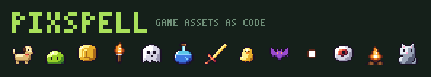

# DOG · Dots Of Games

**코드로 만드는 도트 그래픽.** 440개가 넘는 무료 2D 게임 도트 이미지, **540개가 넘는 게임 이펙트**, **효과음 66개**를 **한 줄로 조합하고, 크기를 바꾸고, 색을 바꿀 수 있습니다.**<br>
**275만 가지** 조합의 캐릭터 메이커도 들어 있고, 캐릭터는 4방향으로 걷고 행동합니다. 모든 스프라이트는 텍스트 파일이고, 의존성은 0개입니다.

[**▶ 데모 게임 하기**](https://olebangpad.github.io/dog/game.html) ·
[플레이그라운드](https://olebangpad.github.io/dog/) ·
[게임 만들기](#-dog로-게임-만들기) ·
[캐릭터 메이커](#-캐릭터-메이커) ·
[이펙트 545종](#-이펙트-545종) ·
[효과음](#-코드로-만든-효과음-66개) ·
[상황 이펙트](#%EF%B8%8F-상황-이펙트) ·
[걷기](#-4방향-걷기) ·
[PNG 바로 받기](#-png만-필요하다면) ·
[코드에서 쓰기](#-코드에서-쓰기) ·
[스프라이트 추가하기](CONTRIBUTING.md) ·
[English](README.md)

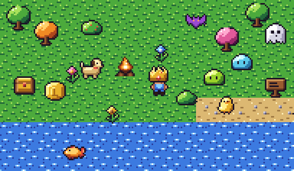

</div>

## 왜 DOG인가요?

일반적인 에셋 팩은 정해진 PNG 묶음이라, 같은 칼을 금색으로 바꾸거나 슬라임을 게임에 맞는 분홍색으로 바꾸려면
다시 그려야 합니다.

DOG는 모든 스프라이트를 **텍스트**로 저장하고, 고정된 색 대신 **색 슬롯**으로 칠합니다.
그래서 어떤 스프라이트든 한 번의 호출로 원하는 색, 크기, 조합으로 바꿀 수 있습니다.

```js
dog('slime', { A: '#ff4fd8' }).scale(8).outline('#fff')
```

### 🎮 DOG로만 만든 게임 화면

[**DOG Quest**](https://olebangpad.github.io/dog/game.html)는 직접 해볼 수 있는 작은 데모입니다. 화면의 모든 픽셀이 이 레포에서 나옵니다.
주인공은 `dog.char()`, 걷기는 `dog.walk()`, 공격은 `dog.action('attack')`, 적이 맞으면 `dog.action('hit')`,
쓰러지면 `dog.action('death')`, 크리티컬·코인 획득·적이 사라지는 연기·레벨업 꽃가루·모닥불 불빛·반딧불은 `dog.fx()`이고,
직접 조작하기 시작하면 공격·타격·코인·레벨업마다 `dog.sfx()` 효과음이 나고, 타일·코인·하트·HUD 글자도 전부 스프라이트와 도트 폰트입니다.
키를 누르기 전까지는 혼자 플레이하고, 캐릭터 메이커의 **▶ Play as this character** 버튼으로 내가 만든 캐릭터로 플레이할 수 있습니다.

<a href="https://olebangpad.github.io/dog/game.html">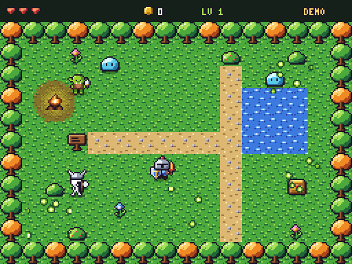</a>

세로형 홍보 영상 (`scripts/record-promo.cjs`로 생성): [English](docs/promo/dog-reel-en.mp4) · [한국어](docs/promo/dog-reel-ko.mp4) ·
이펙트 영상 [English](docs/promo/fx-reel-en.mp4) · [한국어](docs/promo/fx-reel-ko.mp4)

### 🛠 DOG로 게임 만들기

설치 없이 바로 시작하는 것부터 게임 엔진까지, 세 가지 방법이 있습니다.

**1. 템플릿 복사하기.** [`templates/canvas/index.html`](templates/canvas/index.html)은 파일 하나짜리 완성된 작은 게임입니다.
설치도 빌드도 필요 없습니다. [`templates/phaser/`](templates/phaser)는 같은 게임을 Phaser 3와 DOG 게임 팩으로 만든 버전입니다.

**2. 게임 팩 다운로드.** [캐릭터 메이커](https://olebangpad.github.io/dog/#maker)에서 **📦 Game pack**을 누르면 zip 하나에
스프라이트 시트(`idle`, 4방향 `walk`, `attack`, `hit`, `heal`, `levelup`, `cast`, `death`), Aseprite/Phaser용 JSON, Godot 4용 SpriteFrames 파일이 들어 있습니다.
코드로는 `dog.pack(spec)`, 명령어로는 `node scripts/dog.js pack hero --hat crown --hand sword`입니다.

```js
// Phaser 3
this.load.aseprite('hero', 'hero.png', 'hero.json')
const hero = this.add.sprite(160, 120, 'hero').setOrigin(0.5, 31 / 32)
hero.anims.createFromAseprite('hero')
hero.play({ key: 'walk-left', repeat: -1 })
```

**3. AI에게 만들어 달라고 하기.** DOG에는 AI 코딩 도우미용 스킬이 들어 있습니다: [`skills/dog/SKILL.md`](skills/dog/SKILL.md)
(API, 도트 그래픽 규칙, 게임 레시피, 엔진 내보내기)와 [`catalog.md`](skills/dog/catalog.md)(모든 스프라이트 이름). 예제 코드는 CI에서 실제로 실행해 검증합니다.
Claude Code라면 게임 프로젝트 폴더에서:

```bash
mkdir -p .claude/skills/dog && cd .claude/skills/dog
curl -sLO https://raw.githubusercontent.com/olebangpad/dog/main/skills/dog/SKILL.md
curl -sLO https://raw.githubusercontent.com/olebangpad/dog/main/skills/dog/catalog.md
```

그리고 *"DOG로 단검 든 고블린이 슬라임이랑 싸우는 탑다운 게임 만들어줘"*처럼 요청하면 됩니다.
다른 AI 도구는 [`llms.txt`](llms.txt)부터 읽게 하면 됩니다.

### 🧙 캐릭터 메이커

몸에 장비를 **이름만으로** 입힙니다. 몸은 머리와 손 위치를, 장비는 잡히는 지점을 알고 있어서
좌표 없이 알아서 제자리에 붙습니다. 애니메이션도 따라갑니다 (슬라임이 튀면 왕관도 같이 튑니다).

```js
dog.char('hero', { hat: 'crown', hand: 'sword', offhand: 'shield', A: 'red' })   // 24×24 이미지
dog.char('slime-pink', { hat: 'wizard' })
dog.char(dog.char.random(42))                     // 같은 시드 → 같은 캐릭터 (NPC 만들 때 좋아요)
```

몸 12종(영웅, 여자 영웅, 해골, 고블린, 로봇, 강아지, 고양이, 병아리, 슬라임, 유령, 해골 머리, 개구리) × 모자 18종 × 무기 15종 × 보조 장비 6종,
색 변형까지 합치면 옷 색을 바꾸기 전에도 **2,756,176가지** 조합이 나옵니다.

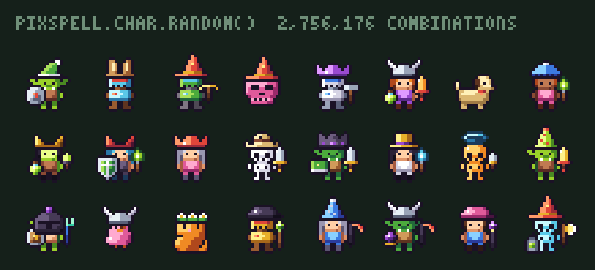

### ⚔️ 상황 이펙트

캐릭터에게 **행동**을 시킬 수 있습니다. 이펙트는 알아서 제자리에 붙습니다. 베기는 무기 든 손에,
데미지 숫자와 "LV UP"은 모자 위에, 연기는 몸 위에 나옵니다. 속성을 고르면 이펙트 색이 바뀌고,
맞을 때는 캐릭터도 불타거나 얼거나 중독된 색으로 변합니다.

```js
const frames = dog.action({ body: 'hero', hat: 'knight', hand: 'sword' }, 'attack', 'fire')
// 항상 32×32 이미지 8프레임, frames.fps 속도로 재생 → 스프라이트 시트에 바로 사용

dog.action('slime', 'hit', { element: 'ice', amount: '-12' })
dog.action('hero-mage', 'cast', '#00ffcc')      // 재질 이름이나 hex 색도 속성으로 쓸 수 있어요
```

**행동 6종**(`attack` 공격, `hit` 피격, `heal` 회복, `levelup` 레벨업, `cast` 시전, `death` 사망) ×
**속성 5종**(`fire` 불, `ice` 얼음, `poison` 독, `holy` 빛, `dark` 어둠)을 275만 가지 캐릭터 누구에게나 쓸 수 있습니다.

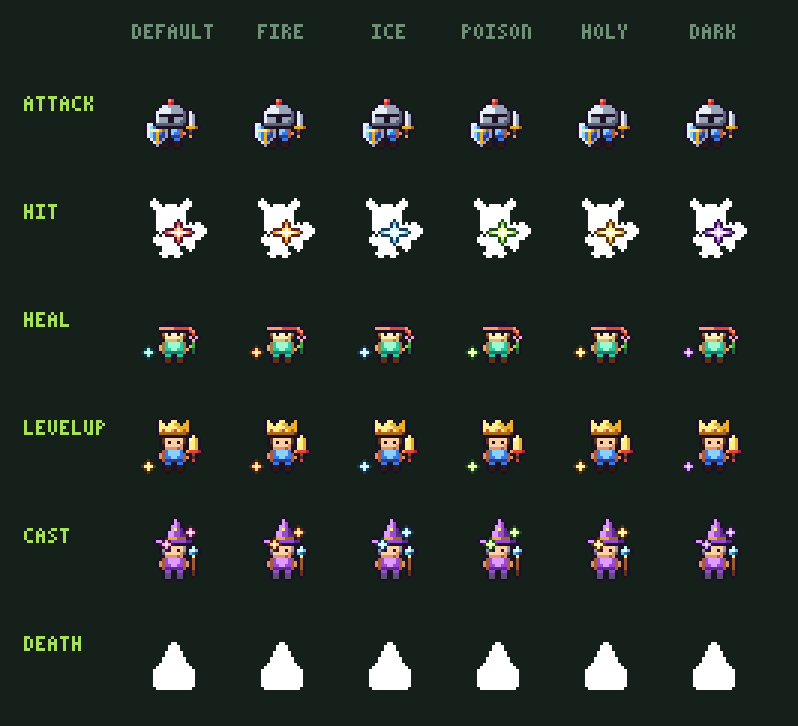

공격 이펙트는 든 무기를 따라갑니다. 검은 베기, 단검은 찌르기, 창은 관통, 망치·도끼는 내려찍기, 활은 화살, 지팡이는 마법,
채찍은 휘두르기, 횃불은 불꽃, 꽃은 뿅망치, 맨손은 주먹. `dog.action.styleOf(spec)`로 확인하고 `{ style: 'whip' }`로 바꿀 수 있습니다.

### ✨ 이펙트 545종

**코드로만 그린 이펙트 80종**이 각각 최대 11가지 색, 원하는 크기로 나옵니다. 여기에 손으로 그린 폭발·반짝임·베기가 더해집니다.
폭발, 마법, 속성, 투사체와 빔, 끝없이 이어지는 날씨, 환경(용암, 안개, 햇살, 물결), 상태이상, 무기별 베기와 타격 피드백(POW, CRIT!, MISS, 막기, 패링),
보상, 그리고 큰 연출(운석, 토네이도, 블랙홀, 소환, 부활, 꽃가루)까지 있습니다.
[**이펙트 페이지**](https://olebangpad.github.io/dog/fx.html)에서 보고, 색을 바꾸고, 내려받을 수 있습니다.

<a href="https://olebangpad.github.io/dog/fx.html">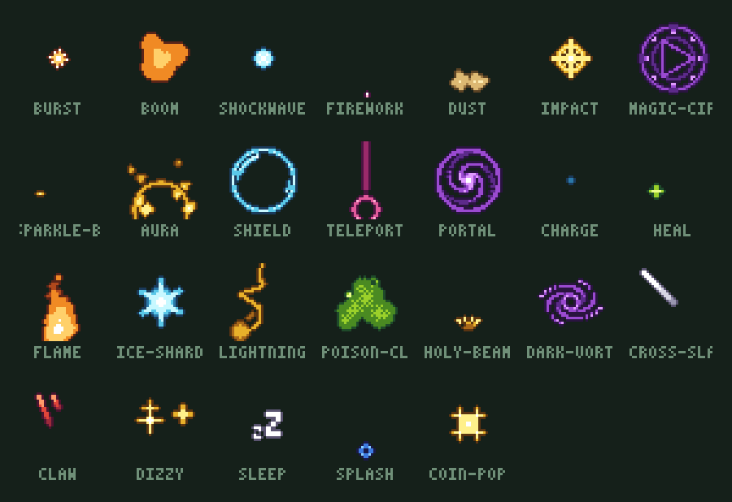</a>

```js
dog.fx('meteor')                                   // 프레임 배열 (32×32), .fps와 .loop 포함
dog.fx('tornado', { element: 'fire', size: 64 })   // 11가지 색이나 hex, 어떤 크기든 선명하게
dog.fx('rain', { size: 64 })                       // 이음새 없는 타일: 맵 전체에 반복해서 깔기
dog.status('slime', 'frozen')                      // 상태이상이 걸린 캐릭터 (32×32)
dog.fx.sequence([{ fx: 'charge' }, { fx: 'comet', repeat: 2 }, { fx: 'boom', with: true, at: -2 }])
dog.fxPack(['meteor', 'poof', 'crit'])             // 시트 한 장 + Phaser/Aseprite JSON + Godot .tres
```

이펙트는 레시피입니다. 빛을 레이어에 칠하는 몇 줄의 코드를 엔진이 음영과 외곽선이 있는 도트로 바꿉니다
([`src/fx/`](src/fx), [추가하는 법](CONTRIBUTING.md#adding-an-effect)). 모든 레시피는 두 배 크기에서도 모양이 유지되는지 테스트합니다.

### 🔊 코드로 만든 효과음 66개

소리도 그림처럼 **파일이 아니라 레시피**입니다. 공격 방식과 행동마다 같은 이름의 소리가 있어서, 무기에 맞는 휘두르는 소리가 저절로 따라옵니다.
이펙트 색을 바꾸듯 **속성**을 더하고, 음높이를 바꾸고, 조금씩 다른 변형을 뽑아서 같은 타격음이 반복돼도 지루하지 않게 할 수 있어요.
[**효과음 페이지**](https://olebangpad.github.io/dog/sfx.html)에서 듣고 내려받을 수 있습니다.

```js
dog.sfx('coin').play()                                  // 브라우저 (첫 소리는 키 입력이나 클릭에서 시작하세요)
dog.sfx(dog.action.styleOf(hero)).play()                // 검 -> 'slash', 망치 -> 'smash', 활 -> 'shoot' ...
dog.sfx('hit', { element: 'ice', seed: 2, pitch: 1.2 }) // 속성 10가지, 변형, 원하는 음높이
dog.sfx(dog.sfx.forEffect('fx-meteor'))                 // 이펙트에 맞는 소리
await dog.sfx('levelup').save('levelup.wav')            // Node; .toWAV()로 어디서든 바이트로
dog.sfxPack(['slash', 'hit', 'coin']).zip()             // WAV 묶음 zip
```

UI 효과음, 점프·발소리, 코인·보석·상자, 무기별 공격음, 타격·크리티컬·막기·패링, 마법, 폭발·운석·지진, 속성 소리,
승리·패배·팡파르 징글, 끊김 없이 반복되는 비·바람·모닥불 소리까지 있습니다. 전부 `assets/sfx/`에 16비트 WAV로 들어 있고 CC0입니다.

### 🚶 4방향 걷기

사람형 캐릭터는 앞·뒤·옆 모습이 따로 그려져 있고, 장비도 방향에 맞게 바뀝니다
(뒤에서 보면 무기가 반대 손에, 옆에서 보면 방패가 몸 뒤로). 동물과 몬스터는 통통 뛰거나 떠다닙니다. `left`는 `right`의 좌우 반전입니다.

```js
dog.walk({ body: 'heroine', hat: 'wizard', hand: 'staff' }, 'left')   // 24×24 프레임, .fps
```

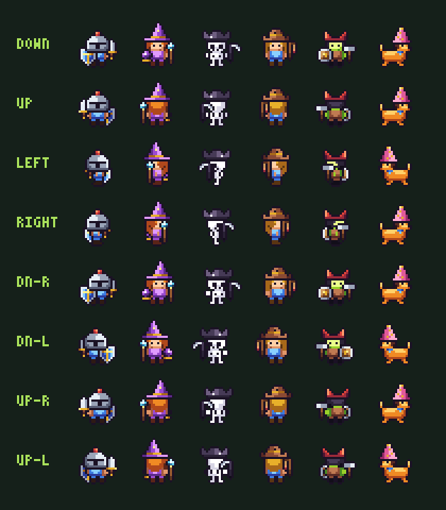

### 🎨 그림 하나로 모든 색을

스프라이트는 최대 3개의 4단계 색 램프(`A`, `B`, `C`)로 칠해져 있습니다. 슬롯을 18가지 재질 중 하나로 바꾸거나,
**아무 hex 색**을 넣으면 명암(색조 이동 포함)이 자동으로 만들어집니다.

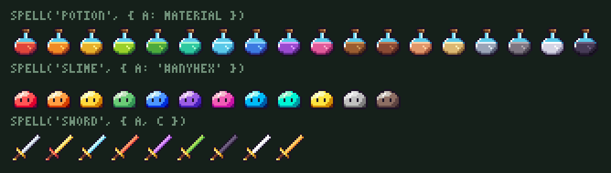

### 🧩 도트끼리 조합

`compose()`로 레이어를 쌓고 `.at(x, y)`로 위치를 잡습니다. 캔버스는 알아서 늘어납니다.

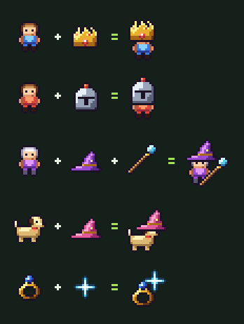

### 🔍 크기를 키우고 줄여도 선명하게

최근접 확대, **Scale2x** 부드럽게 확대, 다수결 축소(외곽선 유지), 외곽선, 그림자, 색조, 뒤집기, 회전을
모두 체인으로 연결할 수 있습니다.

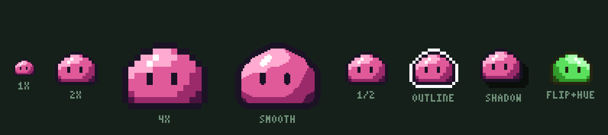

## 🖼 수록 스프라이트

7개 카테고리, 기본 126종, 변형 포함 **441가지**, 이 중 33종은 애니메이션입니다.
캐릭터, 착용 장비, 무기, 방어구, 포션, 보석, 음식, 몬스터, 이어 붙일 수 있는 타일, 소품, UI 아이콘, 말풍선 이모트,
이펙트(폭발, 반짝임, 연기, 타격, 베기)가 들어 있습니다. 여기에 [코드로 만든 이펙트 80종](#-이펙트-545종)이
애니메이션 525가지를 더하고, 이것도 전부 `assets/`에 PNG로 들어 있습니다.

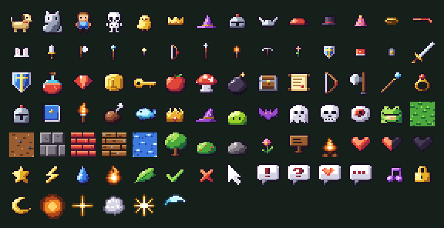

## 📦 PNG만 필요하다면

[`assets/`](assets) 폴더에 모두 미리 뽑아 두었습니다. 빌드할 필요가 없습니다.

| 폴더 | 내용 |
| --- | --- |
| `assets/png/` | 모든 스프라이트 16×16 (예: `potion-mana.png`) |
| `assets/png@4x/` | 같은 이미지 64×64 |
| `assets/anim/` | 애니메이션 PNG (4배) |
| `assets/strips/` | 게임 엔진용 가로 프레임 스트립 (1배) |
| `assets/walk/` | 모든 몸의 4방향 걷기 스트립 |
| `assets/sfx/` | 모든 효과음 (16비트 모노 WAV) |
| `assets/atlas.png` + `atlas.json` | 모든 프레임이 들어간 텍스처 아틀라스 (TexturePacker JSON 형식: `this.load.atlas('dog', 'atlas.png', 'atlas.json')`) |

모든 그림은 **CC0**입니다. 상업용 게임에도 출처 표기 없이 쓸 수 있습니다 (표기해 주시면 감사합니다 ❤).

## 💻 코드에서 쓰기

**브라우저** (설치 없이 jsDelivr로 GitHub에서 바로):

```html
<script type="module">
  import { dog, compose } from 'https://cdn.jsdelivr.net/gh/olebangpad/dog@main/src/index.js'

  const king = compose(dog('hero'), dog('crown').at(0, -7)).scale(8)
  document.body.append(king.toCanvas())
</script>
```

**Node** (레포를 받기만 하면 됩니다. 설치할 것 없음):

```js
import { dog, compose, sheet } from './src/index.js'

await dog('sword', { A: 'gold', C: 'red' }).scale(4).save('gold-sword.png')

const frames = dog.frames('slime-blue')            // 애니메이션 모든 프레임
await sheet(frames).image.scale(4).save('slime-sheet.png')
```

**CLI**:

```bash
node scripts/dog.js list monsters
node scripts/dog.js render potion -A '#ff4fd8' --scale 8 --outline '#fff' -o potion.png
node scripts/dog.js render explosion --anim --scale 4 -o boom.png      # 애니메이션 PNG
node scripts/dog.js combine hero crown@0,-7 --scale 6 -o king.png
node scripts/dog.js char hero-elf --hat wizard --hand staff-fire -A purple --scale 6 -o mage.png
node scripts/dog.js char --random 42 --scale 6 -o npc.png
node scripts/dog.js char hero --hand sword --action attack --element fire --anim --scale 4 -o slash.png
node scripts/dog.js char heroine --hat cowboy --hand rod --walk left --anim --scale 4 -o walk.png
node scripts/dog.js fx meteor --element ice --size 64 -o meteor.png      # 아무 이펙트, 색, 크기
node scripts/dog.js fx burning --on slime --strip -o burning.png        # 캐릭터에 상태이상
node scripts/dog.js fxpack meteor poof crit -o effects.zip              # 이펙트 게임 팩
node scripts/dog.js sfx slash --element fire -o slash.wav              # 효과음 (dog.js sfx만 치면 목록)
node scripts/dog.js sfxpack -o sounds.zip                              # 전체 효과음 WAV
```

TypeScript와 에디터 자동완성: 타입이 [`src/index.d.ts`](src/index.d.ts)에 들어 있습니다.

## ✏️ 스프라이트는 그냥 텍스트

| 문자 | 의미 |
| --- | --- |
| `.` | 투명 |
| `#` | 외곽선 |
| `w` | 흰색 하이라이트 |
| `1 2 3 4` | 램프 **A**, 어두움 → 밝음 |
| `5 6 7 8` | 램프 **B**, 어두움 → 밝음 |
| `a b c d` | 램프 **C**, 어두움 → 밝음 |

픽셀이 색이 아니라 *명암 단계*를 가리키기 때문에 색을 바꿔도 음영이 그대로 유지됩니다.
PR에서도 픽셀 변경이 텍스트 diff로 보입니다.

## 📚 API

| 호출 | 기능 |
| --- | --- |
| `dog(id, { A, B, C, frame })` | 스프라이트 렌더링. `A/B/C`에는 재질 이름, hex 색, 4색 배열 |
| `dog.frames(id, opts)` | 애니메이션 전체 프레임 |
| `dog.list({ category, tag, variants })` | 전체 id 목록 |
| `dog.char(body, { hat, hand, offhand, A })` | 장비를 이름으로 입힌 24×24 캐릭터 |
| `dog.char.frames(spec)` · `dog.char.random(seed)` | 애니메이션 프레임 · 시드로 재현되는 랜덤 캐릭터 |
| `dog.walk(spec, dir)` | 걷기 `down` `up` `left` `right` (24×24 프레임, `.fps`) |
| `dog.action(spec, name, element)` | 행동 애니메이션 8프레임 (32×32, `.fps`) |
| `dog.fx(name, { element, size, seed })` | 코드로 만든 이펙트: `.fps`, `.loop`가 붙은 프레임 배열. 전체 이름은 `dog.fx.list` |
| `dog.fx.sequence(steps)` | 이펙트를 이어 붙이거나 겹쳐서 하나의 애니메이션으로 |
| `dog.status(spec, effect, { walk })` | 상태이상이 걸린 캐릭터 (32×32 프레임) |
| `dog.pack(spec)` · `dog.fxPack(names)` | 게임 팩: 시트 + Aseprite/Phaser JSON + Godot `.tres`, `.zip()`으로 한 파일 |
| `dog.sfx(name, { element, pitch, seed })` | 효과음: `.play()`, `.toWAV()`, `.save(path)`. 목록은 `dog.sfx.list`, 이펙트 소리는 `dog.sfx.forEffect(fx)` |
| `dog.sfxPack(names)` | 효과음 WAV 묶음 zip |
| `compose(...layers)` | 레이어 합성, `.at(x, y)`로 위치 지정 |
| `sheet(images, { columns, gap })` | 스프라이트 시트로 묶기 |
| `text('SCORE 9', { color })` | 내장 3×5 도트 폰트 |

크기: `.scale(n)` `.smooth()` `.resize(w, h)` `.downscale(k)` `.pad()` `.crop()` `.trim()`<br>
색: `.hue()` `.adjust()` `.swap()` `.quantize()` `.tint()` `.grayscale()`<br>
효과/출력: `.outline()` `.shadow()` `.silhouette()` `.flipX()` `.flipY()` `.rotate()` `.toPNG()` `.toCanvas()` `.save()`

재질: `red orange gold lime green mint ice blue purple pink wood leather skin sand iron stone bone shadow`

## 🤝 기여하기

새 스프라이트 추가가 가장 반가운 기여입니다. 2분이면 됩니다.

1. [플레이그라운드](https://olebangpad.github.io/dog/) → **Edit pixels** → 그리기 → **Copy sprite definition**
2. [`src/sprites/`](src/sprites)의 알맞은 파일에 붙여넣고 `variants` 몇 개 추가
3. `npm run check && npm run build` 후 PR

스타일 가이드는 [CONTRIBUTING.md](CONTRIBUTING.md)에 있습니다. 원하는 스프라이트를 이슈로 요청해도 좋습니다.

## 📄 라이선스

- **그림** (`src/sprites/`, `assets/`, `docs/img/`): [CC0 1.0](LICENSE-ASSETS), 퍼블릭 도메인
- **코드**: [MIT](LICENSE)

그림 그리는 시간을 아껴 드렸다면 ⭐ 하나가 다른 개발자들이 이 프로젝트를 찾는 데 큰 도움이 됩니다.
