<div align="center">

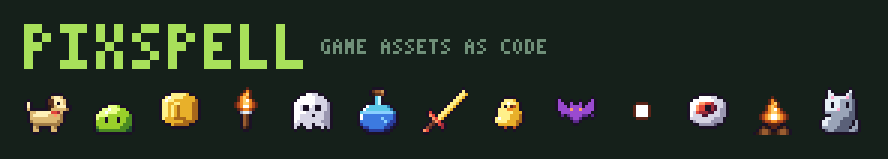

# PixSpell

**Every asset for your 2D game, from code.** Characters that walk and fight, items and tiles, glowing effects and sounds:
generate, recolor and resize them in one line of JavaScript, or ask your AI coding agent to. CC0 art, zero dependencies.

**2.7 million** characters with walk cycles and actions · **845** sprites · **545** effects · **66** sounds · **17** music tracks · any tile size from **8 to 64 px** · Phaser & Godot packs

[**▶ Play the demo**](https://olebangpad.github.io/pixspell/game.html) ·
[**🤖 A game an AI agent made**](examples/spell-survivors) ·
[**🧙 Your GitHub hero**](https://olebangpad.github.io/pixspell/hero.html) ·
[Open the playground](https://olebangpad.github.io/pixspell/) ·
[Make a game](#-make-a-game-with-pixspell) ·
[Character maker](#-character-maker) ·
[Effects](#-545-game-effects) ·
[Sounds](#-66-game-sounds-made-by-code) ·
[Actions](#%EF%B8%8F-actions--effects) ·
[Walking](#-walk-in-4-directions) ·
[Download (8/16/32/64 px)](#-just-want-the-pngs) ·
[Use in code](#-use-it-in-code) ·
[Add a sprite](CONTRIBUTING.md) ·
[한국어](README.ko.md)


[](#-make-a-game-with-pixspell)
[](https://github.com/olebangpad/pixspell/actions/workflows/ci.yml)

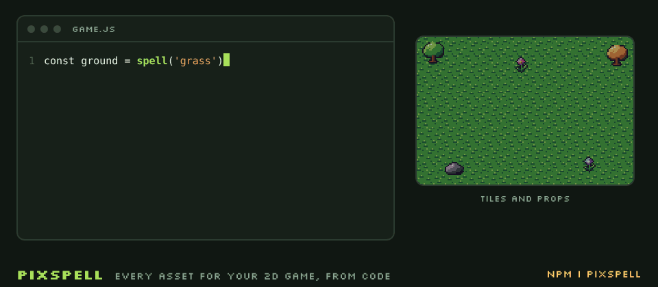

</div>

```js
import { spell } from 'https://cdn.jsdelivr.net/gh/olebangpad/pixspell@main/src/index.js'   // or: npm i pixspell

const knight = spell.char('hero', { hat: 'knight', hand: 'sword', offhand: 'shield' })   // a 24×24 character, gear snapped on
const swing = spell.action('hero', 'attack', { element: 'fire', grid: 32 })              // 8 frames at 64×64, with .fps
spell.sfx('slash', { element: 'fire' }).play()                                           // and its sound
document.body.append(knight.scale(8).toCanvas())
```

### What one line makes

<table>
  <tr>
    <td align="center">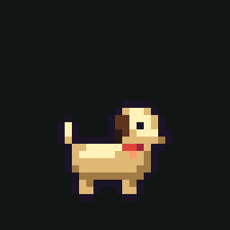<br><sub><code>spell.char.random(seed)</code><br>2.7 million characters</sub></td>
    <td align="center">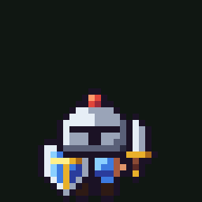<br><sub><code>spell.action(knight, 'attack', 'fire')</code><br>6 actions × 5 elements</sub></td>
    <td align="center">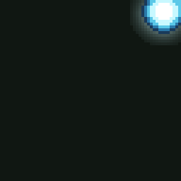<br><sub><code>spell.fx('meteor', { element: 'ice', size: 64 })</code><br>545 effects that glow</sub></td>
  </tr>
  <tr>
    <td align="center">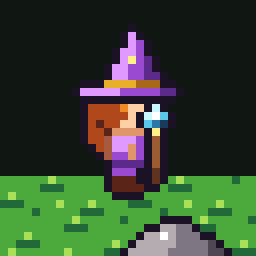<br><sub><code>spell.walk(mage, 'right')</code><br>4-way walk cycles</sub></td>
    <td align="center">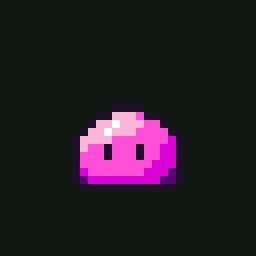<br><sub><code>spell('slime', { A: '#ff4fd8' })</code><br>any sprite, any color</sub></td>
    <td align="center">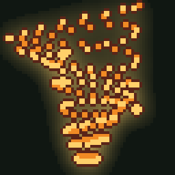<br><sub><code>spell.fx('tornado', { element: 'fire', size: 64 })</code><br>any size, still crisp</sub></td>
  </tr>
  <tr>
    <td align="center">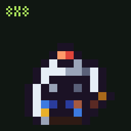<br><sub><code>spell.char(knight, { grid: 8 })</code><br>8, 16, 32 or 64 px tiles</sub></td>
    <td align="center">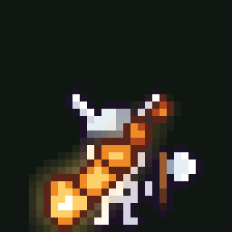<br><sub><code>spell.status(skeleton, 'burning')</code><br>status effects on anyone</sub></td>
    <td align="center">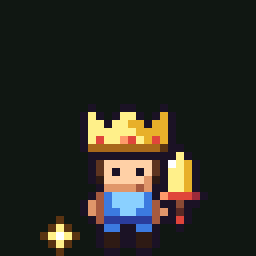<br><sub><code>spell.action(king, 'levelup')</code><br>and a sound for each: <code>spell.sfx('levelup')</code></sub></td>
  </tr>
</table>

<sub>Each tile is drawn by the code under it (zoomed for the README) in <a href="scripts/build.js"><code>scripts/build.js</code></a>.
<code>knight</code> is <code>{ body: 'hero', hat: 'knight', hand: 'sword', offhand: 'shield' }</code>; <code>mage</code>, <code>skeleton</code> and <code>king</code> are specs like it.</sub>

**New:** [42 world-building tiles and props](#-the-collection) · [15 new monsters](#-character-maker) · 26 new items · [a UI kit](#-a-ui-kit) · [music](#-music-made-by-code) · [your GitHub account as a game hero](#-your-github-account-as-a-game-hero) · effects glow · [Spell Survivors](#-a-whole-game-made-by-an-ai-agent-with-pixspell), a game an AI agent built with PixSpell ·
66 sounds · every asset at 8 to 64 px · the skill installs into any Agent Skills client with `npx pixspell skill` · [changelog](CHANGELOG.md)

## Why PixSpell?

Asset packs give you a fixed set of PNGs. When you need the same sword in gold, or a slime in your
game's exact pink, you're stuck redrawing it.

PixSpell stores every sprite as **text**, painted with **color slots** instead of fixed colors, so any of them
can become any color, size or combination in a single call:

```js
spell('slime', { A: '#ff4fd8' }).scale(8).outline('#fff')
```

Other libraries give you one piece, usually effects. PixSpell gives a game **all** of its pieces from one import, so a
person or an AI agent can go from an empty file to a game that looks and sounds finished.

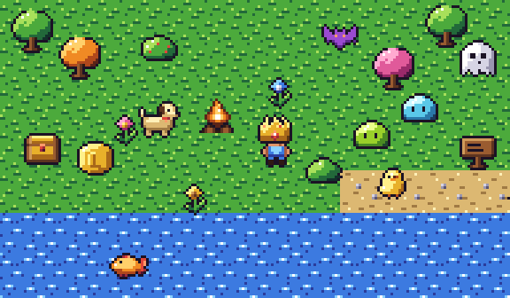

### 🤖 A whole game, made by an AI agent with PixSpell

<a href="https://olebangpad.github.io/pixspell/examples/spell-survivors/">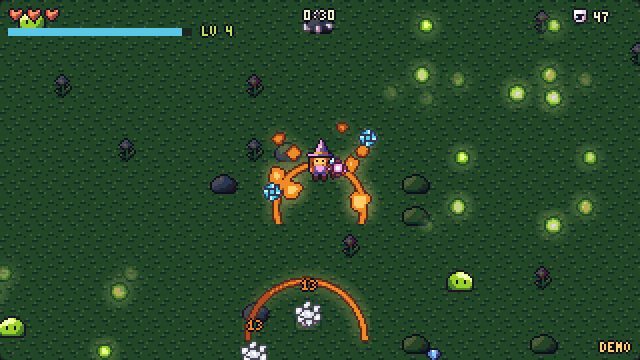</a>


[**▶ Play Spell Survivors**](https://olebangpad.github.io/pixspell/examples/spell-survivors/) ·
[watch it play itself](https://olebangpad.github.io/pixspell/examples/spell-survivors/?demo) ·
[how each part was made](examples/spell-survivors/README.md)

A survivor-style arena game: waves of monsters, spells that fire by themselves, a new spell every level, a sound on every hit.
Claude (in Claude Code) wrote it with the PixSpell skill, using only the public API. **Every sprite, walk cycle, glowing effect
and sound is a PixSpell call.**

**Make your own.** [Install the skill](#-make-a-game-with-pixspell) and give your agent the same idea:

> Make a survivor-style arena game in one HTML file using PixSpell. A wizard walks with the arrow keys, spells fire
> automatically at the nearest enemy, enemies come in growing waves, they drop gems, and every level I pick one of
> three new spells. Use PixSpell for every sprite, effect and sound, with a night-time look so the effects glow.

### 🧙 Your GitHub account as a game hero

<a href="https://olebangpad.github.io/pixspell/hero.html">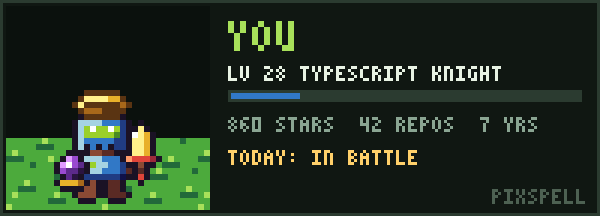</a>

Type a username on the [**hero page**](https://olebangpad.github.io/pixspell/hero.html) and meet its hero. The login picks the look,
the top language the class and colors (TypeScript makes a knight, Go a ranger, Rust a blacksmith, Python a druid),
repos and stars the level (the weapon upgrades at 15 and 35), and the last day's activity what it's doing:
in battle, on a quest, or resting at the inn.

**Put yours on your profile README**, redrawn every day by the PixSpell GitHub Action. In your profile repository
(`github.com/<you>/<you>`) add `.github/workflows/pixspell-hero.yml`:

```yaml
name: PixSpell hero
on:
  schedule: [{ cron: '23 5 * * *' }]   # once a day
  workflow_dispatch:
permissions:
  contents: write
jobs:
  hero:
    runs-on: ubuntu-latest
    steps:
      - uses: actions/checkout@v4
      - uses: olebangpad/pixspell@main
```

Run it once from the **Actions** tab, then add the card to your README:
`[](https://github.com/olebangpad/pixspell)`.
On the command line it's `npx pixspell hero <login>`.

### 🎮 A game screen made only from PixSpell

[**PixSpell Quest**](https://olebangpad.github.io/pixspell/game.html) is a tiny playable demo: every pixel on screen comes from this repo.
The hero is a `spell.char()`, it moves with `spell.walk()`, swings with `spell.action('attack')`, enemies flash with
`spell.action('hit')` and puff away with `spell.action('death')`; crits, coin pops, poofs, level-up confetti, the campfire's glow and the
fireflies are `spell.fx()`; once you take over, every swing, hit, coin and level-up has a `spell.sfx()` sound;
tiles, coins, hearts and the HUD text are sprites and the pixel font.
It plays itself until you press a key, and the character maker has a **▶ Play as this character** button.

<a href="https://olebangpad.github.io/pixspell/game.html">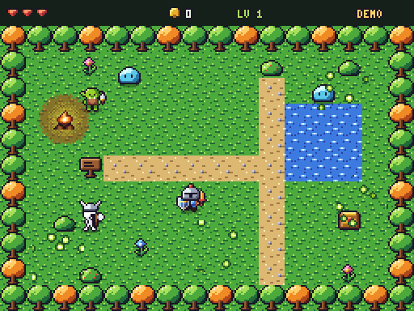</a>

Short vertical promo clips (made by `scripts/record-promo.cjs`): [English](docs/promo/pixspell-reel-en.mp4) · [한국어](docs/promo/pixspell-reel-ko.mp4) ·
effects reel [English](docs/promo/fx-reel-en.mp4) · [한국어](docs/promo/fx-reel-ko.mp4)

### 🛠 Make a game with PixSpell

Three ways in, from zero setup to a full engine:

**1. Copy a starter.** [`templates/canvas/index.html`](templates/canvas/index.html) is a complete little game in one file, with no install
and no build step. [`templates/phaser/`](templates/phaser) is the same idea with Phaser 3 and PixSpell game packs.

**2. Download a game pack.** In the [character maker](https://olebangpad.github.io/pixspell/#maker) press **📦 Game pack**: one zip with a sprite sheet
(`idle`, 4-way `walk`, `attack`, `hit`, `heal`, `levelup`, `cast`, `death`), Aseprite/Phaser JSON and a Godot 4 SpriteFrames file.
In code it's `spell.pack(spec)`; on the command line it's `node scripts/pixspell.js pack hero --hat crown --hand sword`.

```js
// Phaser 3
this.load.aseprite('hero', 'hero.png', 'hero.json')
const hero = this.add.sprite(160, 120, 'hero').setOrigin(0.5, 31 / 32)
hero.anims.createFromAseprite('hero')
hero.play({ key: 'walk-left', repeat: -1 })
```

**3. Let your AI coding agent build it.** PixSpell is plain code and text, so an agent can use all of it without
touching an image file. It ships a skill: [`skills/pixspell/SKILL.md`](skills/pixspell/SKILL.md) (the API, rules for crisp pixel art,
a full game recipe, engine exports, sounds, tile sizes) and [`catalog.md`](skills/pixspell/catalog.md) (every sprite id). Its code samples run in CI.

- **Claude Code:** install it as a plugin, then just ask.
  ```
  /plugin marketplace add olebangpad/pixspell
  /plugin install pixspell@pixspell
  ```
- **Codex, Cursor, Gemini CLI, GitHub Copilot, OpenCode** and the other [Agent Skills clients](https://agentskills.io/clients):
  run this in your project. It copies the skill into `.agents/skills/pixspell/`, where those agents look for skills
  (`--claude` puts it in `.claude/skills/` instead).
  ```
  npx pixspell skill
  ```
- **Any agent, nothing to install:** paste this into the chat.
  > Read https://raw.githubusercontent.com/olebangpad/pixspell/main/skills/pixspell/SKILL.md and use PixSpell for every
  > sprite, effect and sound. Then make a top-down game where a goblin with a dagger fights slimes.

Then ask something like *"make a top-down game where a goblin with a dagger fights slimes, with sounds, using PixSpell"*.
Agents can also read [`llms.txt`](llms.txt).

**Let the agent see what it picks.** Names don't show what a sprite looks like, so PixSpell gives agents eyes:

- `npx pixspell preview slime meteor "spell.action('hero', 'attack', 'fire')"` draws one image with every frame, zoomed,
  plus the size, frames and fps of each. The skill tells agents to check their picks with it.
- **MCP server** (no dependencies): `claude mcp add pixspell -- npx -y pixspell mcp`, or `npx -y pixspell mcp` in any MCP
  client. Its `preview` tool hands the image straight to the agent with the JavaScript call for each item; `catalog`
  finds names, `save` and `pack` write PNGs, WAVs and engine packs into the project.
- `npx pixspell doctor` checks Node, rendering, and which skill copies your agents will read.

### 🧙 Character maker

Put gear on a body **by name**. Bodies know where their head and hands are, gear knows where it's held,
so everything snaps into place, no coordinates needed. Hats ride along with animations (a slime's crown bounces with it).

```js
spell.char('hero', { hat: 'crown', hand: 'sword', offhand: 'shield', A: 'red' })   // 24×24 Pixmap
spell.char('slime-pink', { hat: 'wizard' })
spell.char(spell.char.random(42))                     // same seed → same character, great for NPCs
```

27 bodies × 18 hats × 15 held items × 6 off-hand items, with color variants: **2,761,072 combinations** before you even
change the outfit color. Bodies are people (hero, heroine, skeleton, goblin, robot), animals (dog, cat, chick) and every monster.

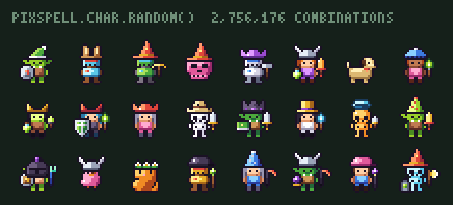

**21 monsters, and each one is a body:** slime, bat, ghost, skull, eye, frog, spider, snake, rat, wolf, mushroom monster,
crab, beetle, golem, imp, will-o-wisp, jellyfish, biting plant, mimic, bee and a baby dragon, each in 3 to 6 colors
(`wolf-fox`, `golem-lava`, `mimic-gold`, `baby-dragon-black`...). So they wear hats, walk, attack, get hit, level up and
die like any character: `spell.walk('golem', 'left')`, `spell.action({ body: 'mimic', hat: 'pirate' }, 'attack')`.

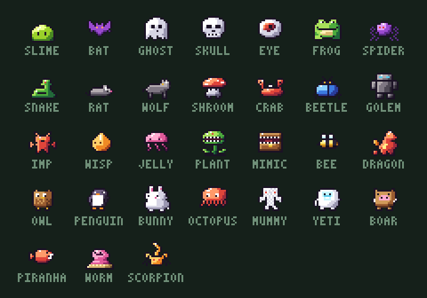

### ⚔️ Actions & effects

Make any character **do something**. Effects attach to the right spot by themselves: the slash at the weapon hand,
damage numbers and "LV UP" above the hat, smoke over the body. Pick an element and the effect follows it;
on a hit the target burns, freezes or turns sick too.

```js
const frames = spell.action({ body: 'hero', hat: 'knight', hand: 'sword' }, 'attack', 'fire')
// always 8 frames of 32×32, play them at frames.fps: drop straight into a sprite sheet

spell.action('slime', 'hit', { element: 'ice', amount: '-12' })
spell.action('hero-mage', 'cast', '#00ffcc')      // any material or hex works as an element
```

**6 actions** (`attack` `hit` `heal` `levelup` `cast` `death`) × **5 elements** (`fire` `ice` `poison` `holy` `dark`) on any of the 2.7 million characters.

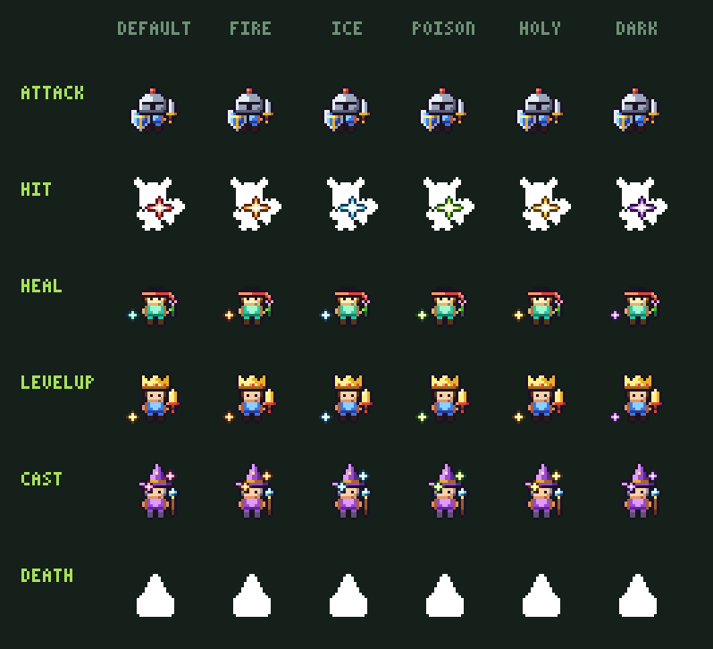

Attacks follow the weapon: swords slash, daggers stab, spears thrust, hammers and axes smash, bows shoot, staffs cast,
whips crack, torches burn, flowers bonk, empty hands punch. `spell.action.styleOf(spec)` tells you which; `{ style: 'whip' }` overrides it.

### ✨ 545 game effects

**80 effect designs drawn entirely by code**, each in up to 11 colors and at any size, plus the hand-drawn explosions, sparkles and slashes.
Bursts, magic, elements, projectiles and beams, seamless weather, environment (lava, fog, sunrays, ripples), status overlays,
weapon slashes and hit feedback (POW, CRIT!, MISS, block, parry), rewards, and big moments (meteor, tornado, black hole, summon, revive, confetti).
Browse, recolor and download them on the [**effects page**](https://olebangpad.github.io/pixspell/fx.html).

<a href="https://olebangpad.github.io/pixspell/fx.html">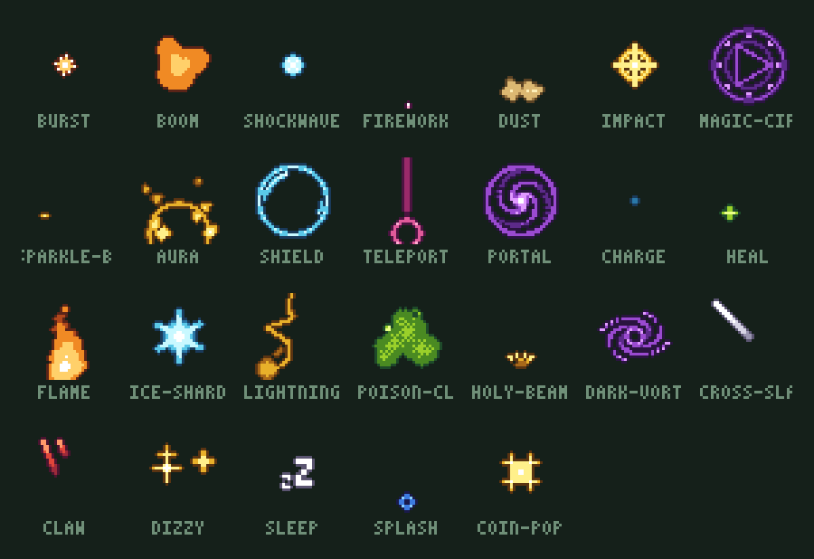</a>

```js
spell.fx('meteor')                                   // frames (32×32) with .fps and .loop
spell.fx('tornado', { element: 'fire', size: 64 })   // 11 colors or any hex, any size, still crisp
spell.fx('rain', { size: 64 })                       // seamless: repeat the tile over a whole map
spell.status('slime', 'frozen')                      // a character with a status effect on (32×32)
spell.fx.sequence([{ fx: 'charge' }, { fx: 'comet', repeat: 2 }, { fx: 'boom', with: true, at: -2 }])
spell.fxPack(['meteor', 'poof', 'crit'])             // one sheet + Phaser/Aseprite JSON + Godot .tres
```

Effects are recipes: a few lines that paint light into layers, which the engine turns into shaded, outlined pixel art
(see [`src/fx/`](src/fx) and [how to add one](CONTRIBUTING.md#adding-an-effect)). A test checks that every recipe keeps its layout when drawn at double size.

### 🔊 66 game sounds, made by code

Sounds work like the art: **recipes, not files**. Every attack style and action has one, so the right swing sound comes with
the weapon. Add an **element** the way you'd recolor an effect, change the pitch, or roll small variations so repeated hits
don't sound identical. Listen and download on the [**sounds page**](https://olebangpad.github.io/pixspell/sfx.html).

```js
spell.sfx('coin').play()                                  // browser (start the first sound from a key press or click)
spell.sfx(spell.action.styleOf(hero)).play()                // sword -> 'slash', hammer -> 'smash', bow -> 'shoot'...
spell.sfx('hit', { element: 'ice', seed: 2, pitch: 1.2 }) // 10 element flavors, variations, any pitch
spell.sfx(spell.sfx.forEffect('fx-meteor'))                 // the sound that goes with an effect
await spell.sfx('levelup').save('levelup.wav')            // Node; .toWAV() bytes anywhere
spell.sfxPack(['slash', 'hit', 'coin']).zip()             // WAVs in one zip
```

UI blips, jumps and steps, coins, gems and chests, every weapon swing, hits, crits, blocks and parries, spells, explosions,
meteors and quakes, element sounds, win / lose / fanfare jingles, and seamless rain, wind and campfire loops.
All of them are pre-exported in `assets/sfx/` as 16-bit WAV, CC0.

### 🎵 Music, made by code

17 chiptune tracks: seamless loops for the title screen, town, field, forest, dungeon, cave, battle, boss, shop, night,
castle, desert, snow and ocean, plus `victory`, `level-clear` and `game-over` jingles. The engine writes each part from a
few lines of song data (tempo, key, chords, style): a melody with a hook that comes back and a cadence home, a bass line,
arpeggios or pads, and drums, with the same voices as the sound effects. Listen on the [**sounds page**](https://olebangpad.github.io/pixspell/sfx.html#music-grid).

```js
const music = spell.music('town').play()             // loops until music.stop()
spell.music('battle', { tempo: 1.1, key: 2 })        // faster, two semitones up
spell.music('dungeon', { seed: 1 })                  // the same style, a new melody
await spell.music('boss').save('boss.wav')           // Node; or: npx pixspell music boss
```

### 🚶 Walk in 4 directions

Humanoids have drawn front, back and side poses; gear follows the view (the weapon swaps hands from behind,
the shield tucks behind the body from the side). Animals and monsters hop or float. `left` mirrors `right`.

```js
spell.walk({ body: 'heroine', hat: 'wizard', hand: 'staff' }, 'left')   // frames (24×24), .fps
```

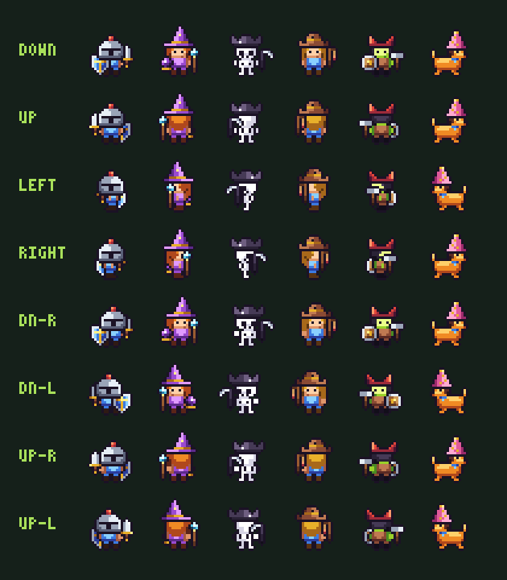

### 🎨 One drawing, any color

Each sprite paints with up to three 4-shade ramps (`A`, `B`, `C`). Swap a ramp for one of 18 hand-tuned
materials, or pass **any hex color** and PixSpell builds a hue-shifted ramp for you.

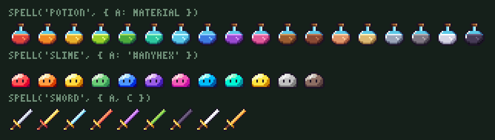

### 🧩 Combine sprites into new ones

Stack sprites as layers with `compose()` and offset them with `.at(x, y)`. The canvas grows to fit.

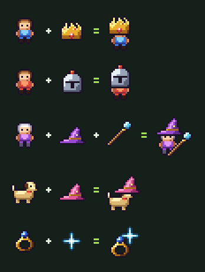

### 🔍 Resize and effects that stay crisp

Nearest-neighbor upscaling, **Scale2x** smoothing, majority-vote downscaling (outlines survive),
outlines, drop shadows, hue shifts, flips and rotations, all chainable.

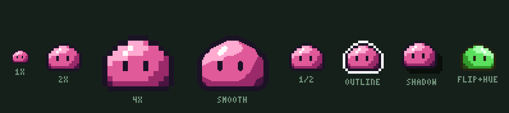

## 🖼 The collection

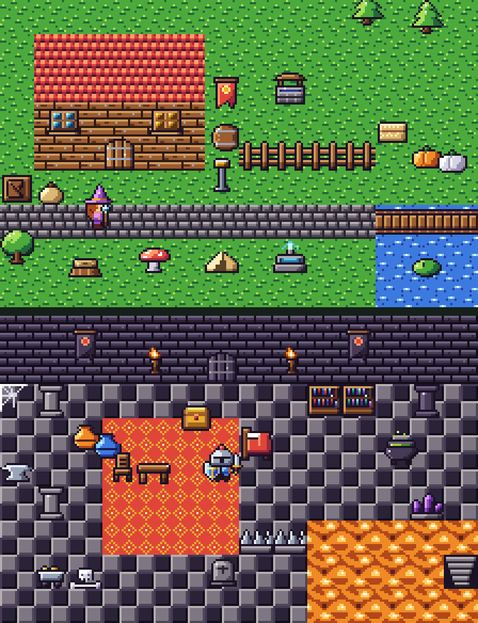

**Build a whole world:** a village and a dungeon room, every pixel a PixSpell sprite. Doors, windows, roofs, fences,
wells, lamp posts, barrels, crates, sacks, beds, tables, chairs, bookshelves, cauldrons, anvils, banners, tents, wall
torches, pillars, spike traps, stairs, cobwebs, bones, tombstones, mine carts and rails, cactus, pine trees, giant
mushrooms, crystals and lily pads, plus seamless cobblestone, roof tiles, carpet, checkered floors, bridges and
flowing lava. Each comes in several materials (`door-iron`, `roof-slate`, `lava-toxic`, `crystals-amethyst`...).

224 base sprites in 7 categories, **845 looks** with variants, 54 of them animated.
Characters, wearable gear, weapons (dagger, spear, hammer, wand...), armor, boots, amulets, potions, gems, food (bread, cheese, cake, carrot, egg, grapes...),
treasure and quest items (gold bars, trophy, map, compass, hourglass, letter, runes...), monsters, seamless tiles, props, furniture, UI icons,
emote bubbles and effects (explosions, sparkles, smoke, hits, slashes). On top of that, the [80 procedural effects](#-545-game-effects)
add 525 more animated looks; all of them are exported in `assets/` too.

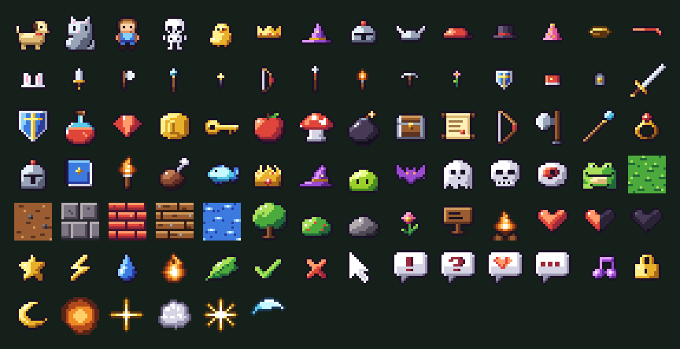

### 🪟 A UI kit

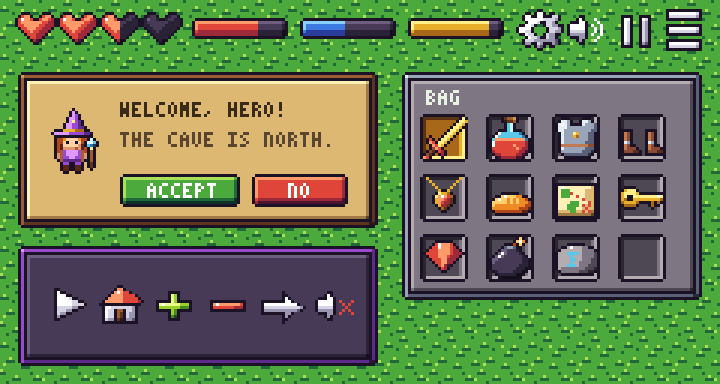

Panels, inventory slots and buttons stretch to any size with their frames intact: `spell('panel').nineSlice(160, 64)`.
A 32×8 `bar` comes as health, mana, XP, stamina, shield and empty, and there are icons for settings, sound on and off,
pause, play, home, menu, plus, minus and arrows next to the hearts, stars, checks and locks. Everything above is
[about 30 lines in `scripts/build.js`](scripts/build.js).

```js
const dialog = spell('panel').nineSlice(160, 64)                                   // corners stay crisp
const hpBar = spell('bar-empty').draw(spell('bar').crop(0, 0, 1 + Math.round(30 * hp), 8), 0, 0)
```

## 📦 Just want the PNGs?

**Pick your tile size and get everything in one zip:** [**download page**](https://olebangpad.github.io/pixspell/#download).
Choose 8×8, 16×16, 32×32 or 64×64 (what people call 8-bit / 16-bit / 32-bit pixel art) and you get sprites, characters with
walk strips, effects and sounds made for that grid:

| tile | how it's made |
| --- | --- |
| **8×8** | half size by vote, then the 1px outline is drawn again (eyes and seams are kept) |
| **16×16** | the original pixels |
| **32×32** · **64×64** | Scale2x once or twice: rounded stair steps, like art drawn at that size, not fat pixels |
| effects | drawn again at the new size by their recipe (a 64×64 tile gets real 128 px effects) |

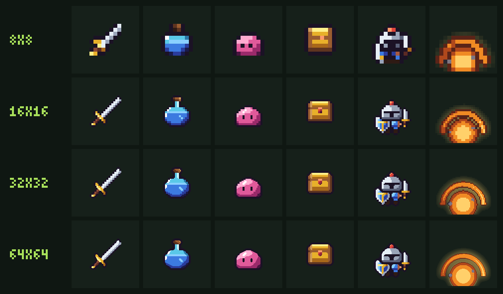

In code it's one option: `spell('sword', { grid: 32 })`, `spell.char(spec, { grid: 8 })`, `spell.pack(spec, { grid: 64 })`.
On the command line: `node scripts/pixspell.js export --grid 32` writes `pixspell-32px.zip`.

The 16 px originals are also pre-exported in [`assets/`](assets). No build step needed.

| Folder | What's inside |
| --- | --- |
| `assets/png/` | every look at 16×16, e.g. `potion-mana.png` |
| `assets/png@4x/` | the same at 64×64 |
| `assets/anim/` | animated PNGs (4x) of every animated look |
| `assets/strips/` | horizontal frame strips (1x) for game engines |
| `assets/walk/` | walk-cycle strips for every body in every direction |
| `assets/sfx/` | every sound effect as a 16-bit mono WAV |
| `assets/atlas.png` + `atlas.json` | one texture atlas with every frame (TexturePacker JSON hash: `this.load.atlas('pixspell', 'atlas.png', 'atlas.json')`) |

All art is **CC0**: use it in commercial games, remix it, no credit required (credit is appreciated ❤).

## 💻 Use it in code

**Browser** (no install, straight from GitHub via jsDelivr):

```html
<script type="module">
  import { spell, compose } from 'https://cdn.jsdelivr.net/gh/olebangpad/pixspell@main/src/index.js'

  const king = compose(spell('hero'), spell('crown').at(0, -7)).scale(8)
  document.body.append(king.toCanvas())
</script>
```

**npm** (Node 18+, bundlers, TypeScript types included):

```bash
npm i pixspell
npx pixspell render potion -A '#ff4fd8' --scale 8 -o potion.png   # the CLI comes with it
```

```js
import { spell, compose, sheet } from 'pixspell'

await spell('sword', { A: 'gold', C: 'red' }).scale(4).save('gold-sword.png')

const frames = spell.frames('slime-blue')            // every animation frame
await sheet(frames).image.scale(4).save('slime-sheet.png')
```

PixSpell is ES modules only (no `require`). Everything hangs off one object, `spell` (`dog` still works: it was the early name). Versions follow semver: until 1.0, a minor release may change the API
and the [changelog](CHANGELOG.md) says how. Or clone the repo and import `./src/index.js`; nothing to install.

**CLI** (`npx pixspell ...` after installing, or `node scripts/pixspell.js ...` in a clone):

```bash
node scripts/pixspell.js list monsters
node scripts/pixspell.js render potion -A '#ff4fd8' --scale 8 --outline '#fff' -o potion.png
node scripts/pixspell.js render explosion --anim --scale 4 -o boom.png      # animated PNG
node scripts/pixspell.js combine hero crown@0,-7 --scale 6 -o king.png
node scripts/pixspell.js char hero-elf --hat wizard --hand staff-fire -A purple --scale 6 -o mage.png
node scripts/pixspell.js char --random 42 --scale 6 -o npc.png
node scripts/pixspell.js char hero --hand sword --action attack --element fire --anim --scale 4 -o slash.png
node scripts/pixspell.js char heroine --hat cowboy --hand rod --walk left --anim --scale 4 -o walk.png
node scripts/pixspell.js fx meteor --element ice --size 64 -o meteor.png      # any effect, color, size
node scripts/pixspell.js fx burning --on slime --strip -o burning.png        # status effect on a character
node scripts/pixspell.js fxpack meteor poof crit -o effects.zip              # effects as a game pack
node scripts/pixspell.js sfx slash --element fire -o slash.wav              # a sound effect (pixspell.js sfx lists them)
node scripts/pixspell.js sfxpack -o sounds.zip                              # every sound as WAVs
node scripts/pixspell.js export --grid 32                                   # everything for 32x32 tiles in one zip
node scripts/pixspell.js char hero --hat crown --walk left --grid 64 -o w.png  # --grid works on render, char, fx, pack
node scripts/pixspell.js hero octocat -o hero.png                         # a GitHub account as a game hero card
node scripts/pixspell.js skill                                              # install the skill for your coding agent
```

TypeScript and editors: types ship in [`src/index.d.ts`](src/index.d.ts), so `spell.` autocompletes.

## ✏️ Sprites are just text

```js
{
  id: 'heart',
  ramps: { A: 'red' },          // slot A starts as the "red" material
  art: `
    ...###....###...
    ..#344#..#344#..
    .#3w443##34432#.
    .#344444443322#.
    .#334444433222#.
    ..#3344433222#..
    ...#33433222#...
    ....#333222#....
    .....#3322#.....
    ......#21#......
    .......##.......
  `,
}
```

| Char | Meaning |
| --- | --- |
| `.` | transparent |
| `#` | outline |
| `w` | white highlight |
| `1 2 3 4` | ramp **A**, dark → light |
| `5 6 7 8` | ramp **B**, dark → light |
| `a b c d` | ramp **C**, dark → light |

Because pixels point at *shades* instead of colors, shading survives every recolor. Pixel diffs show
up in pull requests as plain text diffs.

## 📚 API

```js
import { spell, compose, sheet, text, Pixmap } from './src/index.js'
```

| Call | Does |
| --- | --- |
| `spell(id, { A, B, C, frame })` | render a sprite. `A/B/C` take a material name, any hex color, or 4 colors |
| `spell.frames(id, opts)` | every frame of an animation, in play order |
| `spell.list({ category, tag, variants })` | ids of all looks |
| `spell.char(body, { hat, hand, offhand, A, B, C })` | 24×24 character with gear snapped on by name |
| `spell.char.frames(spec)` · `spell.char.random(seed)` | animation frames · a reproducible random character |
| `spell.char.parts` · `spell.char.count()` | every body / hat / hand / off-hand id · number of combinations |
| `spell.walk(spec, dir)` | walk cycle `down` `up` `left` `right` (24×24 frames, `.fps`) |
| `spell.action(spec, name, element)` | 8 frames (32×32, `.fps`) of a character doing `attack` `hit` `heal` `levelup` `cast` `death` |
| `spell.fx(name, { element, size, seed, light })` | a procedural effect: frames with `.fps` and `.loop`, glowing (`light: false` for flat); `spell.fx.list` has every name |
| `spell.fx.sequence(steps)` | chain or overlap effects into one animation |
| `spell.status(spec, effect, { walk })` | a character with a status effect on it (32×32 frames) |
| `spell.pack(spec)` · `spell.fxPack(names)` | game packs: sheet + Aseprite/Phaser JSON + Godot `.tres`, `.zip()` for one file |
| `spell.sfx(name, { element, pitch, seed })` | a sound: `.play()`, `.toWAV()`, `.save(path)`; `spell.sfx.list`, `spell.sfx.forEffect(fx)` |
| `spell.sfxPack(names)` | sounds as WAV files in one zip |
| `spell.music(name, { key, tempo, seed })` | chiptune music: a seamless loop or a jingle, as a Sound. Tracks: `spell.music.list`, `spell.music.info(name)` |
| `{ grid: 8 \| 16 \| 32 \| 64 }` | an option on every call above: art for that tile size (`smooth: false` for plain zoom) |
| `spell.toGrid(img, grid)` · `spell.bundle({ grid })` | convert any PixSpell image · every file for one tile size, for your own exporter |
| `compose(...layers)` | stack layers; place them with `.at(x, y)` |
| `sheet(images, { columns, gap })` | pack into a sprite sheet → `{ image, frames }` |
| `text('SCORE 9', { color })` | built-in 3×5 pixel font |

Every `Pixmap` method returns a new image, so calls chain:

| Size | Color | Effects / output |
| --- | --- | --- |
| `.scale(n)` (`0.5` halves) | `.hue(deg)` | `.outline(color)` |
| `.smooth()` (Scale2x) | `.adjust({ hue, saturation, lightness })` | `.shadow(color, dx, dy)` |
| `.resize(w, h)` | `.swap(from, to)` | `.silhouette(color)` |
| `.downscale(k)` | `.quantize(palette)` | `.flipX()` `.flipY()` `.rotate(90)` |
| `.pad(n)` `.crop()` `.trim()` `.nineSlice(w, h)` | `.tint(color, amount)` `.grayscale()` | `.toPNG()` `.toCanvas()` `.save(path)` |

Materials: `red orange gold lime green mint ice blue purple pink wood leather skin sand iron stone bone shadow`

## 🤝 Contributing

New sprites are the best contribution, and it takes about two minutes:

1. Open the [playground](https://olebangpad.github.io/pixspell/) → **Edit pixels** → draw → **Copy sprite definition**
2. Paste it into the right file in [`src/sprites/`](src/sprites) and add a few `variants`
3. `npm run check && npm run build`, then open a PR

See [CONTRIBUTING.md](CONTRIBUTING.md) for the style guide. Sprite requests are welcome as issues too.

### Ideas on the roadmap

- [x] Character maker with automatic gear placement
- [x] Character actions: attack / hit / heal / level-up / cast / death, in 5 elements
- [x] Walk cycles in 4 directions
- [x] Playable demo game screen
- [x] Game packs for Phaser / Godot, starter templates, AI skill
- [x] 500+ procedural effects in any color and size, an effects gallery, weapon-aware attacks
- [x] TypeScript types, visual regression tests
- [x] Sound effects made by code, matched to every attack, action and effect
- [x] Every download at 8, 16, 32 or 64 px tiles
- [x] Effects that glow; a whole game built by an AI agent; the skill for any Agent Skills client
- [ ] More bodies (each one adds ~180,000 combinations)
- [ ] PNG → text art importer
- [ ] More palettes (limit the whole set to a 16- or 32-color palette)
- [ ] 32×32 characters with walk cycles
- [ ] Normal maps, so sprites react to 2D lights
- [ ] 8-direction walks
- [ ] npm package

## 🙏 Credits

- The smoothing behind 32 and 64 px tiles is **Scale2x**, Andrea Mazzoleni's take on the EPX algorithm ([scale2x.it](https://www.scale2x.it/)).
- The sound engine borrows the idea behind DrPetter's **sfxr**: a game sound is a handful of numbers, not a recording.
- The website and promo clips use the **Silkscreen** font by Jason Kottke.
- Every sprite, effect and sound in this repository was drawn or written for PixSpell.

## 📄 License

- **Everything PixSpell draws or plays** (the sprite art, and every image, effect and sound the library generates, at any size): [CC0 1.0](LICENSE-ASSETS), public domain. Use it in commercial games; no credit needed
- **Code**: [MIT](LICENSE)

If PixSpell saved you some drawing time, a ⭐ helps other devs find it.
