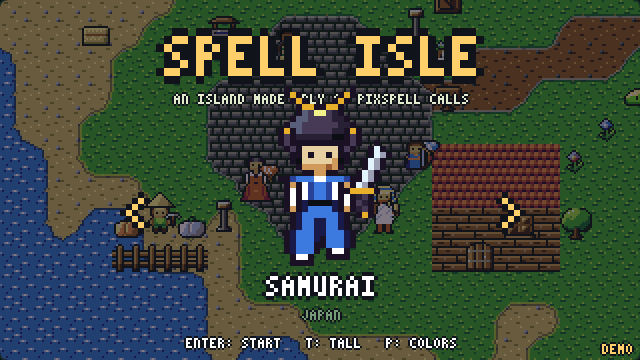

# Spell Isle

A small island adventure: pick a hero, walk around an island, talk to people from around the world, and fight
monsters in turn-based battles until you reach the Dragon King. **Every tile, character, walk cycle, blow, effect,
sound and song comes from PixSpell calls.** There are no image or audio files, only [`index.html`](index.html), under 600 lines.

[▶ Play it](https://olebangpad.github.io/pixspell/examples/spell-isle/) ·
[watch it play itself](https://olebangpad.github.io/pixspell/examples/spell-isle/?demo)



Arrows / WASD or tap to move. Walk into a monster to fight, then pick 1-4 (attack, magic, potion, run). The fountain
in the village heals you. P switches to retro colors, M mutes.

## What each part comes from

| in the game | PixSpell call |
| --- | --- |
| the island: sea, beaches, grass, the road, the plaza, the dragon's den | a height map → `spell.autotile('dirt-sand' / 'grass' / 'dirt' / 'cobblestone' / 'stone', null).draw(cells)`, over `spell.frames('water')` |
| houses, trees, the fountain, the well, graves, crystals | `spell('roof')`, `spell('planks')`, `spell('door')`, `spell.frames('fountain')`, `spell('pine-tree')` ... |
| the heroes and the villagers, some drawn tall | `spell.char.world` presets, `spell.walk({ ...spec, height: 24 }, 'down-right')` (8 directions) |
| monsters wandering and chasing you | `spell.walk({ body: 'wolf' }, dir)`, `spell.char.frames(spec)` when they stand still |
| **every blow in a battle** | `spell.act(hero, monster, { element, amount: '-5', ko })`: wind-up, step in, hit-stop, the reaction, the knock-out |
| the monster's turn | the same call swapped and mirrored: `spell.act(monster, hero, opts).flipX()` |
| the screen shake and the sounds of a blow | `act.hits[0]` (when, how long) and `act.cues` (`spell.sfx(sound, opts)` at their times) |
| magic that hits a weak spot | `spell.act(hero, monster, { style: 'magic', element: 'fire' })` |
| a potion, a level up | `spell.action(hero, 'heal', { amount: '+10' })`, `spell.action(hero, 'levelup')` |
| confetti, fireworks, the fountain's sparkle | `spell.fx('confetti')`, `spell.fx('firework', { size: 64 })`, `spell.fx('heal')` |
| music for the title, the village, the meadow, the den, battles, the boss, a win | `spell.music.play('title' / 'town' / 'field' / 'dungeon' / 'battle' / 'boss' / 'victory')` |
| Game Boy, PICO-8, Sweetie 16, C64 and 1-bit colors | `spell.palette('gameboy')`, then everything is drawn again; text with `spell.toPalette(img, name)` |
| the HUD, speech bubbles, the battle menu | `spell('heart', { grid: 8 })`, `spell('panel').nineSlice(w, h)`, `text('YOUR TURN')` |

## How a battle works

The hero stands at a spot and the monster 26 px (times the zoom) to the right, which is where `spell.act` puts the
target. A turn is one call:

```js
const act = spell.act(hero, monster, { element: 'fire', amount: '-6', ko: hp <= 6, shake: 0 })
// draw act[frame] with act.feet.attacker on the hero's spot, 12 frames a second;
// at act.hits[0].time, take the damage and shake the whole screen for act.hits[0].freeze seconds;
// play each act.cues[i] when its time comes
```

`shake: 0` leaves the shake out of the frames, so the game shakes the whole screen instead. The monster's turn is
`spell.act(monster, hero, opts).flipX()`: the same choreography from the right, with its damage number still reading
left to right.
