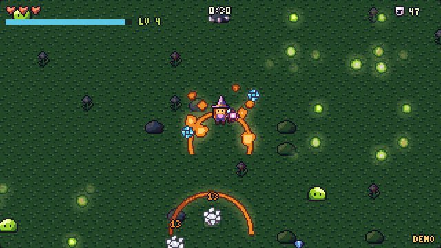

# Spell Survivors

A small survivor-style arena game: you walk, your spells fire by themselves, enemies come in waves, and every level
you pick a new spell. **Every sprite, walk cycle, death animation, glowing effect and sound comes from PixSpell
calls.** There are no image or audio files, just [`index.html`](index.html), about 450 lines.

[▶ Play it](https://olebangpad.github.io/pixspell/examples/spell-survivors/) ·
[watch it play itself](https://olebangpad.github.io/pixspell/examples/spell-survivors/?demo)



## How it was made

Claude (in Claude Code) wrote this game while PixSpell was being built. It uses only the public API in
[`skills/pixspell/SKILL.md`](../../skills/pixspell/SKILL.md): the same skill you can install. Nothing here reaches
into the library's internals.

What each part comes from:

| in the game | PixSpell call |
| --- | --- |
| the wizard and every enemy, walking in 4 directions | `spell.walk({ body: 'heroine', hat: 'wizard', hand: 'staff' }, dir)` |
| enemies dying | `spell.action(spec, 'death')` |
| magic bolt, fire aura, frost nova, lightning, meteor, ice blades | `spell.fx('orb' / 'aura' / 'shockwave' / 'lightning' / 'meteor' / 'spinner', { element, size })` |
| burning and frozen enemies | `spell.fx('burning')`, `spell.fx('frozen')` drawn over them |
| XP gems and HUD hearts at 8×8 | `spell('gem-sapphire', { grid: 8 })`, `spell('heart', { grid: 8 })` |
| the arena | `spell('grass')`, `spell('tree')`, `spell('flower')`, `spell('rock')` |
| spell icons on the level-up cards | `spell('flame')`, `spell('bolt')`, `spell('sword', { A: 'ice' })`, ... |
| every sound | `spell.sfx('magic' / 'hit' / 'poof' / 'gem' / 'levelup' / 'zap' / 'meteor' / 'ice' / 'hurt' / 'lose')` |
| numbers and labels | `text('LV 3')` |

## Make your own with an AI coding agent

Install the skill, then ask. In Claude Code:

```
/plugin marketplace add olebangpad/pixspell
/plugin install pixspell@pixspell
```

> Make a survivor-style arena game in one HTML file using PixSpell. A wizard walks with the arrow keys, spells fire
> automatically at the nearest enemy, enemies come in growing waves, they drop gems, and every level I pick one of
> three new spells. Use PixSpell for every sprite, effect and sound, with a night-time look so the effects glow.

Your game will differ from this one (agents don't write the same code twice), but the assets will all be there.
Other agents (Codex, Cursor, ...) can read [`SKILL.md`](../../skills/pixspell/SKILL.md) or [`llms.txt`](../../llms.txt).
